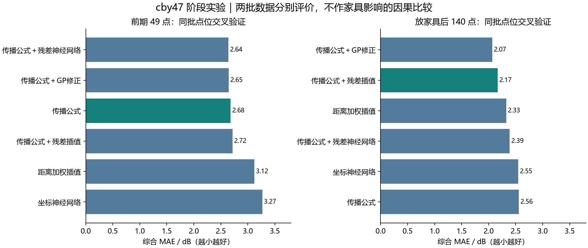
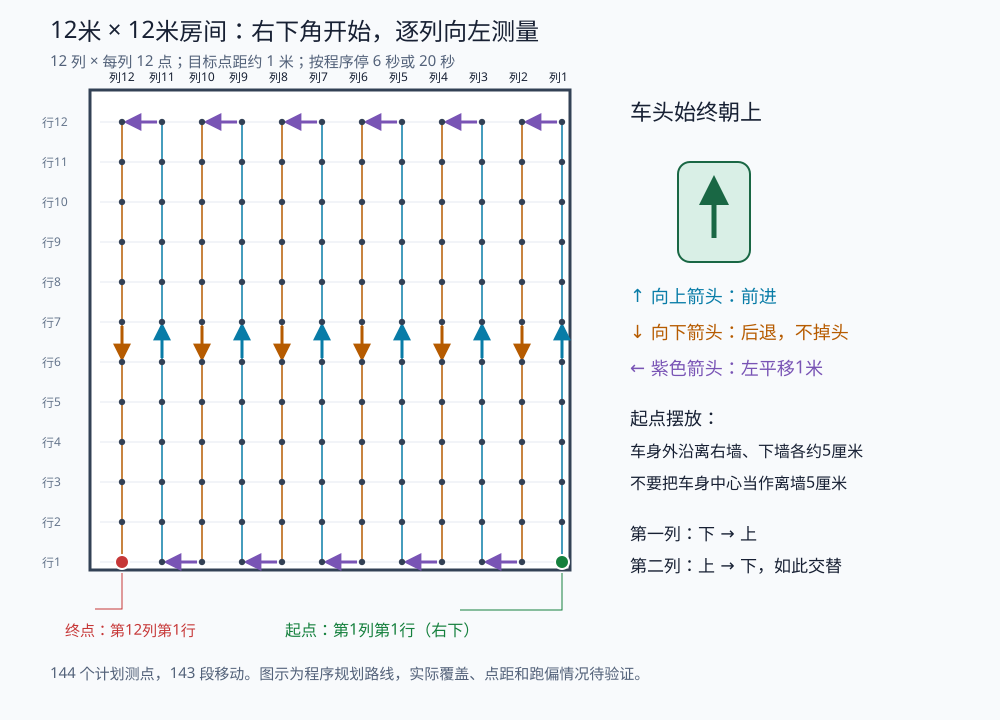

# cby47 个人阶段成果

贡献者：[@cby47](https://github.com/cby47)；整理日期：2026-11-06。

## 完成的工作

我先整理了固定房间的 Wi-Fi RSSI 测量，制作实测与预测热力图，并比较传播公式、IDW、坐标神经网络、公式加残差神经网络、公式加 GP、公式加残差插值六种方案。随后开发小车网格巡测程序，为更密集的采集准备移动与停车能力。

| 批次 | 数据处理 | 评价与结论 |
|---|---|---|
| 前期 49 点 | 每点为单次读数，保留原始坐标 | 公式综合 MAE 2.68 dB；残差神经网络 2.64 dB，差距较小，推荐公式作基础 |
| 放家具后 140 个有效点 | 12×12 表内有 4 个空格，未补造；采集者确认后为 120 个省略负号的数值补回负号 | GP 修正综合 MAE 2.07 dB 最低；按同样的 0.2 dB 简单方案优先规则，推荐残差插值，MAE 2.17 dB |

每种方法在每个位置上，分别得到一条随机留出预测和一条空间留出预测；两批实验的点数、位置及采集条件不同，不能把误差差异解读为家具的因果影响。两套模型均是开发阶段探索性评估，尚未以新的独立采集完成前瞻验证。

此次坐标原点在右下内墙角，x 向上、y 向左；与主线 `rfmap/` 的 x/y 命名互换。放家具后实验暂沿用旧路由器位置，该位置尚需本轮采集者确认。家具位置只叠加展示，没有作为网络输入；不能据此预测任意家具搬动后的信号。

RSSI 超出任务书参考区间的点仍保留。过强值需要复核采集高度、朝向和接收端表现；当前单次读数不足以证明稳定性或设备饱和。

## 小车工程

平台为 miniAuto 麦克纳姆轮小车、Arduino Uno 和 Mixly 2.0。我分别实车调试前进、后退、左平移，修正左后轮后退方向，调整左移轮速并排查右后轮接触不良。最终顺序积木规划 12 列 × 12 点，前进、后退、左移时长分别为 5.00、5.12、5.20 秒，按点安排 6 秒或 20 秒停留，可电池供电并由 KEY1 启动。

三个动作已分别实车调试。最终全图程序按项目记录通过 Uno 编译，本次贡献未附原始编译日志，未重做编译。144 是计划点数；整图覆盖、累计位置误差和 ESP32 记录完整性仍待验证。

## 成果证据

- [最终 Mixly / Arduino 工程](../../hardware/grid_car/10_全图检测_顺序积木/)与[三个独立动作测试](../../hardware/grid_car/)。
- [前期 49 点指标](../../outputs/member-progress/cby47/metrics-49.csv)、[放家具后 140 点指标](../../outputs/member-progress/cby47/metrics-140.csv)：仅发布汇总，无逐点坐标和读数。
- [Wi-Fi 实验代码与模拟演示](../../experiments/rssi_baselines/)：本地已完成模拟训练、绘图和模型重载查询验证。

原始 Excel、现场图纸、含真实读数的截图及现场模型保留在本地，公开权限确认后再提交。这里是个人实验补充，不把历史 CNN、同房间交叉验证和跨房间仿真成绩合并排名，也不据此宣布完成 PRD 的多部署验收。
