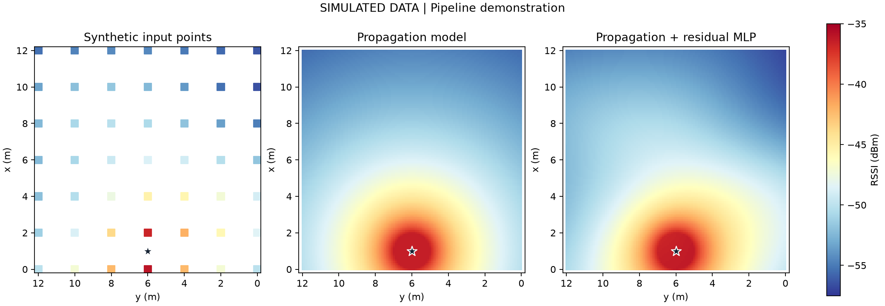

# 固定路由器 RSSI 基线比较实验

此目录是 @cby47 的独立比较实验，不替换主线 `rfmap/` 的 CNN/U-Net 实现，也不表示已完成 PRD 的部署整组验收。

## 运行

从仓库根目录执行（已验证 Python 3.12）：

```bash
python -m pip install -r experiments/rssi_baselines/requirements.txt
python experiments/rssi_baselines/optimize_wifi.py
python experiments/rssi_baselines/plot_heatmap.py
python experiments/rssi_baselines/predict_optimized.py --x 2 --y 6
```

默认使用 `examples/synthetic_rssi.csv`，是明确标记的模拟数据，不是现场实测。运行后生成 `optimized/`，不提交生成的模型、逐点预测和本地数据。



## 实测数据

将已获使用许可的 CSV 留在本地 `private/`。CSV 表头为 `x_m,y_m,rssi_dbm`；每个位置一条数值读数，至少 10 个不共线位置，覆盖至少 5 个空间块。重复采样先按位置汇总；不要把同一位置的重复记录分到训练和测试两侧。

```bash
python experiments/rssi_baselines/optimize_wifi.py --input private/measurements.csv --room 12 12 --router 1 6
python experiments/rssi_baselines/plot_heatmap.py --input private/measurements.csv
```

上述参数是演示值，使用现场数据时应替换为实际尺寸和路由器坐标。所有测点保留，过强/过弱点需要在采集记录与报告中标注。单次强读数不能据此认定硬件饱和或设备故障。

## 评价

六种方法共用外层 5 折随机留出和 3×3 空间块逐块留出。每折训练集内部进行 3 折空间选参，标准化和公式校准只使用对应训练数据。综合 MAE 对两种外层任务等权平均；距最低 MAE 不超过 0.2 dB 时，按实现复杂度优先选简单方法。这个阈值是工程偏好，不代表显著性检验。

历史两批实验使用固定的 4 米分块，保留在本地划分文件中；当前通用脚本按实际房间尺寸等分九块。因此公开的模拟演示用于验证流程，不能复现未公开的现场数据成绩。

## 坐标对接

本目录约定原点为右下角，**x 向上、y 向左**。主线 `rfmap/` 约定 **x 向左、y 向上**。对接必须交换两轴，并同步交换房间宽高与路由器坐标。原始测量坐标保留，不为匹配图纸而擅自缩放。
